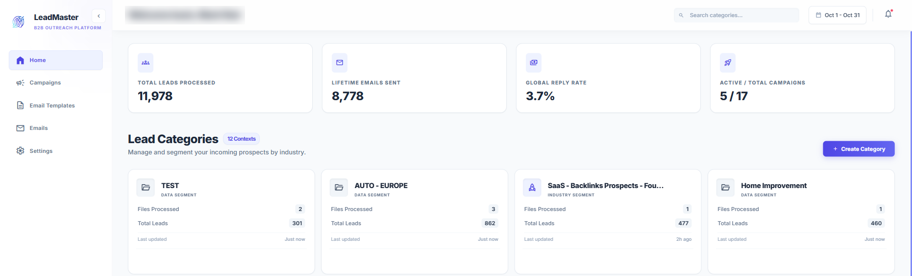

  

  
  
  

**LeadMaster replaces manual lead research and copywriting for B2B cold outreach.** For every lead it reads their LinkedIn profile and company website, writes a personal first email with Claude or GPT-4o, sends from several Gmail inboxes, follows up three times in the same thread, and stops the moment the lead replies.

It runs real campaigns: **8,778 emails sent with a 3.7% reply rate**, above the 1–3% usually quoted for cold email.

## The live dashboard

  

The production dashboard: leads processed, lifetime emails sent, reply rate across all campaigns, and leads grouped by industry.

## How it works

  

| Step | What happens |
|---|---|
| **1. Collect** | Leads come in by CSV upload or from scraping and data tools (Apify, Apollo), and are grouped into categories by industry and region. |
| **2. Research** | An n8n workflow reads each lead's LinkedIn profile and company website. |
| **3. Write** | Claude or GPT-4o writes a personal first email from that research, following the campaign's template and tone. |
| **4. Send** | Campaigns spread sending across several Gmail inboxes, with three threaded follow-ups per lead. |
| **5. Listen** | Every inbox is scanned for replies. Each reply is matched to its lead by thread ID, that lead's sequence stops, and the dashboard updates. |
| **6. Improve** | Sends, replies and bounces per campaign and per day show which segment and which message work. |

## Results

| Measure | Value |
|---|---:|
| Leads processed | **11,978** |
| Emails sent (lifetime) | **8,778** |
| Reply rate, all campaigns | **3.7%** |
| Campaigns run | **17** |
| Lead categories | **12** |

## Production practices

- **Background workers** do the sending and the reply scanning, so the dashboard never waits on Gmail.
- **Reply-safe sequences:** a lead who replies never gets another automated follow-up.
- **Multi-inbox sending** spreads volume across inboxes to protect deliverability.
- **Accounts** are verified with an emailed one-time code (OTP).
- **Deployment:** Nginx with TLS in front of FastAPI on a Linux server, with PostgreSQL.

## Tech stack

  
  
  
  
  
  
  
  
  

---

  Built by <a href="https://github.com/ahmed-hussain-ai"><b>Ahmed Hussain</b></a> · <a href="https://ahmedhussain.tech">ahmedhussain.tech</a> 
  The source code is kept in a private repository. Happy to walk through it in an interview.

