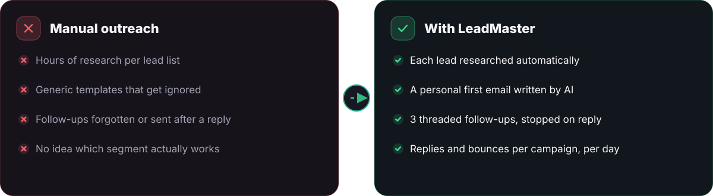
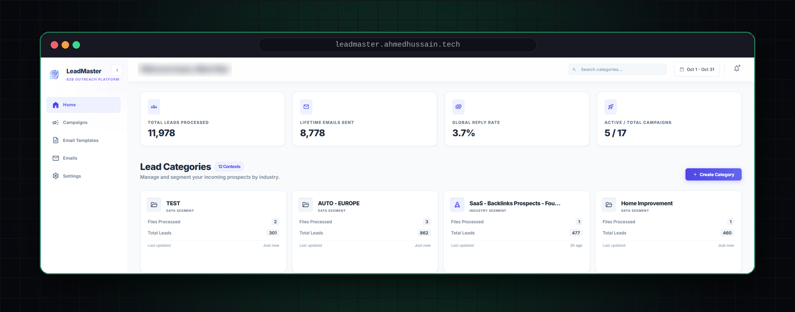
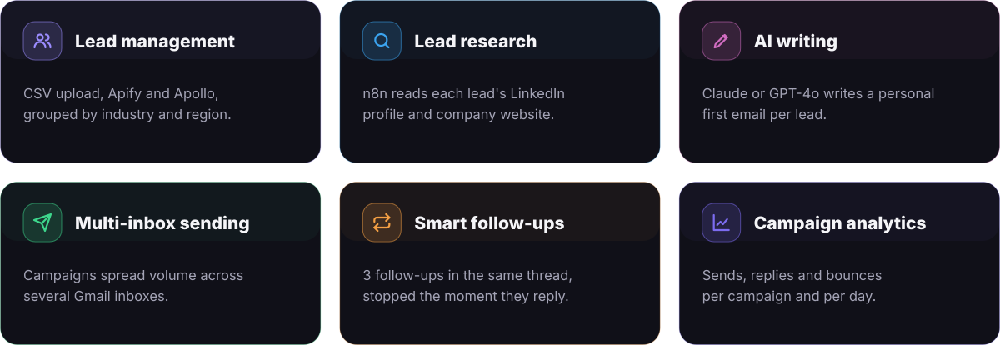
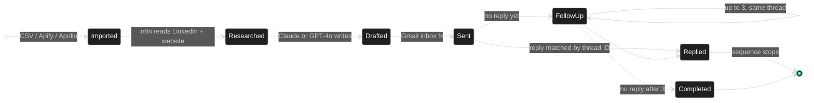
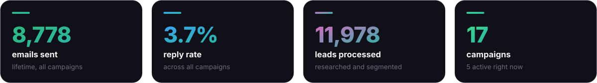

  

  
  
  
  

  <a href="#01"><b>Why</b></a> &nbsp;·&nbsp; <a href="#02"><b>Dashboard</b></a> &nbsp;·&nbsp; <a href="#03"><b>Features</b></a> &nbsp;·&nbsp; <a href="#04"><b>Pipeline</b></a> &nbsp;·&nbsp; <a href="#05"><b>Results</b></a> &nbsp;·&nbsp; <a href="#06"><b>Production</b></a> &nbsp;·&nbsp; <a href="#07"><b>Stack</b></a>

 

**LeadMaster replaces manual lead research and copywriting for B2B cold outreach.** For every lead it reads their LinkedIn profile and company website, writes a personal first email with Claude or GPT-4o, sends from several Gmail inboxes, follows up three times in the same thread, and stops the moment the lead replies.

 

The production dashboard: leads processed, lifetime emails sent, reply rate across all campaigns, and leads grouped by industry.

 

 

<b>The life of one lead</b> (state diagram)

 

 

 

| Decision | Why |
|---|---|
| **Research before writing** | A personal first line comes from real facts about the lead, not a merge field. That is what lifts replies above the usual 1–3%. |
| **Sending from real Gmail inboxes** | Mail comes from a real person's inbox, and volume is spread across several inboxes to protect deliverability. |
| **Threaded follow-ups** | Follow-ups land in the same thread, so the lead sees one conversation instead of four cold emails. |
| **Reply matching by thread ID** | Every inbox is scanned, and a reply stops that lead's sequence, so nobody gets a follow-up after answering. |
| **Background workers** | Sending and inbox scanning run in workers, so the dashboard never waits on Gmail. |
| **Per-campaign, per-day analytics** | Sends, replies and bounces show which segment and which message work, so campaigns change on results. |

 

  

  
  
  
  
  
  

 

  
   The source code is private. Happy to walk through it in an interview.

